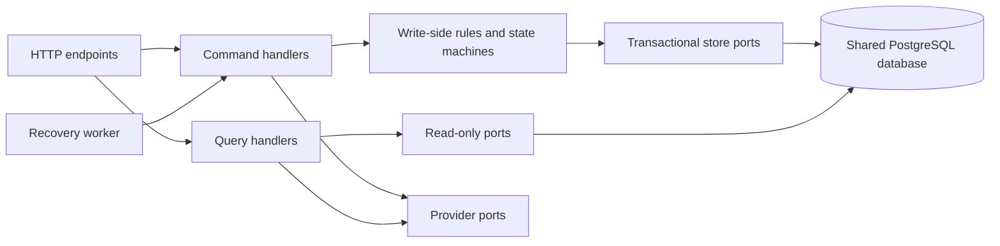

# CQRS architecture

JARVIS uses in-process CQRS: requests that change state or perform an external operation
are commands; reads are queries. HTTP endpoints bind inputs, invoke a typed handler,
and map the result to HTTP. Background recovery jobs invoke the same command boundary.

## Boundaries

- `Jarvis.Contracts`: API request/response records shared with clients.
- `Jarvis.Orchestrator/Cqrs`: command/query records, typed handler contracts and handlers,
  grouped by sessions, devices, learning, tools and integrations.
- `Jarvis.Orchestrator/Runtime` and `Sessions`: write-side validation, state transitions,
  idempotency, scheduling and transaction orchestration used by command handlers.
- `ISessionReader` and `IRuntimeReader`: query-side ports without write operations.
- `ISessionStore` and `IRuntimeStore`: transactional write ports; commands may also read
  current state to validate a transition. CQRS does not prohibit command-side reads.
- `Jarvis.Persistence`: EF Core/PostgreSQL implementations and readiness adapter.
- `Jarvis.Api/Integrations`: HTTP adapters implementing application-owned provider ports.
- `Jarvis.Api/Endpoints`: feature-specific HTTP mappings, with typed handler injection.
- `Jarvis.Api/CqrsRegistration.cs`: explicit composition; no reflection-based dispatch.

Handlers are grouped by feature when they share dependencies. No handler implements both
command and query interfaces. Queries do not call the former mixed read/write services;
the list/get methods were removed from those services. Daily briefing composition lives
in its query handler rather than in an endpoint.

Examples: `CreateSession` and `ReviewLearningItem` are commands; `GetSession` and
`ListLearningItems` are queries. `TranscribeAudio` is an immediate command because it invokes
a metered external operation. Its caller owns the stream; it is not a durable queue message.

## Consistency and scope

Reads and writes use the same database and the same backing store instances. Successful
commands are immediately visible to queries. Existing PostgreSQL row locks, unique indexes,
confirmation rules and idempotency behavior remain in the write side. No schema migration
is needed for this refactor, and existing HTTP routes and response shapes are unchanged.

This implements CQRS without event sourcing, a message broker, separate read replicas or
asynchronous projections. Those introduce operational costs and eventual consistency;
they are not necessary for the present single-user workload. A separate optimized read
store can later implement the read-only ports if measurements justify it.

The code is more clearly separated, but CQRS is not a claim of complete production
hardening. The existing shared-key security model, JSON runtime document, provider setup
limits and lack of durable SignalR replay still apply. `DomainException` currently carries
HTTP status information, which remains a pragmatic coupling in the application layer.

## Verification

Architecture tests verify every request has a registered handler, handlers do not mix
commands and queries, query handlers do not depend on write services/stores, read and
write ports share backing state, and queries leave persistent state unchanged. Existing
API, database, concurrency, provider and browser scenarios verify the public behavior.
