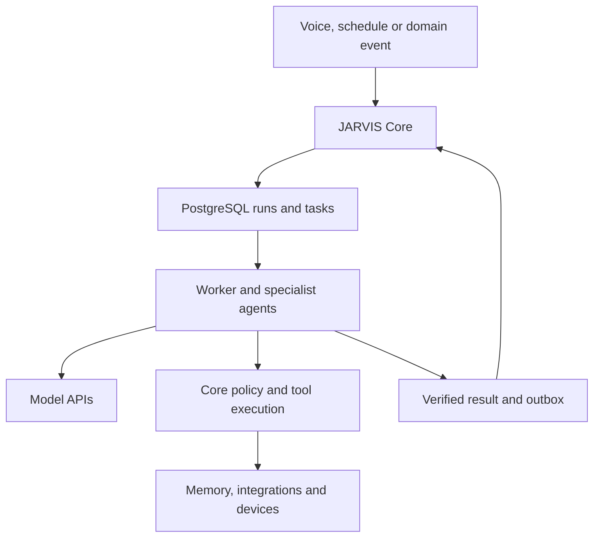

# JARVIS — Personal AI Operating System
## Master Requirements & Proactive Agent Architecture

> **PRODUCT INVARIANT:** Every client and specialist must feel like the same JARVIS session, memory and personality. No module may introduce a second independent assistant experience unless that is explicitly approved as a future product decision.

**Date:** 13 November 2026  
**Status:** Authoritative working baseline for implementation  
**Supersedes:** `JARVIS_REQUIREMENTS_vNext_2026-11-13.md` and `JARVIS_AGENT_SWARM_REQUIREMENTS_2026-11-13.md`  
**Purpose:** Provide one implementation-ready requirements baseline covering JARVIS Core, Android Companion, voice, interview/technical/communication coaching, real-interview processing, persistent memory, proactive automation and the specialist AI-agent swarm.

### Source traceability

This master file merges the two named requirements documents. The broader specialist-agent catalogue (Career, Finance, Travel, Personal Planner, Home, Learning, Coding/Engineering and Health/Fitness) reflects the current JARVIS design discussion and is marked as a planned extension of the same governed agent runtime.

---

## Single-Product Principle

**JARVIS is one product.** Android, Windows, room voice, Meta Quest, Home Assistant, interview coaching, technical training, communication coaching, automation, memory, and the agent swarm are not separate products.

They are clients, modules, capabilities, and specialist agents inside one unified JARVIS Personal AI Operating System.

The architecture must preserve:

- One JARVIS identity and user account.
- One persistent memory and learning history.
- One session model that can move between devices.
- One orchestration and permission layer.
- One agent runtime and policy gateway.
- One canonical Story Bank, CV context, goals and weakness model.
- One notification and proactive-planning system.
- One audit trail and budget-control model.

A user should experience JARVIS as a single continuous assistant regardless of whether the current interface is Android, Windows, room voice, VR or another future client.

Specialist agents are internal implementation details. They may collaborate behind the scenes, but they must not behave like disconnected assistants with separate memories, personalities, permissions or competing plans.

`Jarvis.Android`, `Jarvis.WindowsAgent`, `Jarvis.InterviewCoach`, `Jarvis.TechnicalTrainer`, `Jarvis.CommunicationCoach`, `Jarvis.InterviewRecorder`, `Jarvis.Automation`, and future specialist agents are all parts of the same product and share JARVIS Core contracts, identity, memory, policy and session state.

---

## 1. Product Vision

JARVIS is a continuously improving, voice-first Personal AI Operating System that works across the user's Windows laptop, Samsung phone, room voice hardware, future mini-PC, smart-home devices and future Meta Quest client.

The system should support:

- Natural hands-free conversation using a wake phrase such as **“Hey Jarvis”**.
- Persistent memory, session continuity and cross-device handoff.
- Senior software-engineering interview preparation.
- Technical drills covering C#/.NET, distributed systems, system design, databases, APIs, security, DevOps, payments and coding.
- Interview storytelling and project defence.
- Communication improvement, including slower and clearer speech.
- Social confidence, networking, small talk and workplace communication.
- Personal planning, routines, household/life skills and smart-home assistance.
- Proactive but non-intrusive coaching based on recurring weaknesses and upcoming goals.
- A governed specialist-agent runtime that can proactively research, plan, analyse, draft, monitor and coordinate authorised work across career, learning, personal planning, home and other approved domains.

JARVIS should be useful throughout the day, including when the user is away from the laptop and only has a phone and earphones.

---

## 2. Core Architecture

### 2.1 JARVIS Core

Use an **ASP.NET Core modular monolith** initially.

JARVIS Core owns:

- Authentication and authorisation.
- Conversation orchestration.
- Session ownership.
- Permissions and tool execution.
- Planning and goal management.
- Coaching state.
- Persistent memory.
- Device registry.
- Cross-device coordination.
- Audit history.
- Learning progress.
- Interview-performance history.
- Proactive workflow orchestration and durable agent runs.
- Agent/tool policy enforcement, approvals and audit.
- API/model budget enforcement and usage accounting.
- Evidence/provenance tracking for research and agent-generated claims.

Do not split into microservices unless a concrete operational requirement justifies it.

### 2.2 Main modules

- `Jarvis.Api`
- `Jarvis.Orchestrator`
- `Jarvis.Voice`
- `Jarvis.Memory`
- `Jarvis.Coaching`
- `Jarvis.InterviewCoach`
- `Jarvis.CommunicationCoach`
- `Jarvis.TechnicalTrainer`
- `Jarvis.Automation`
- `Jarvis.Integrations`
- `Jarvis.Contracts`
- `Jarvis.Worker`
- `Jarvis.WindowsAgent`
- `Jarvis.InterviewRecorder`
- `Jarvis.AgentRuntime` — specialist registration, typed handoffs, run/task state and agent execution policies.
- `Jarvis.Policy` — permission, approval, budget and tool-execution gateway.
- `Jarvis.Tests`

Primary clients/adapters:

- `Jarvis.Android` — Kotlin + Jetpack Compose thin Android companion.
- `Jarvis.WindowsAgent` — Windows laptop/device integration.
- Dedicated room voice endpoint.
- Meta Quest Unity/OpenXR client.
- Home Assistant adapter.

### 2.3 Data

Use PostgreSQL as the source of truth for:

- Sessions.
- Conversation transcripts.
- Story Bank.
- Interview attempts.
- Technical-question history.
- Communication metrics.
- Preferences.
- Schedules.
- Learning progress.
- Weakness history.
- Goals.
- Audit logs.
- Agent workflow definitions and versions.
- Agent runs, tasks and attempts.
- Tool intents and approvals.
- Durable schedules/triggers.
- Outbox records.
- Usage/cost reservations and reconciliations.
- Evidence/provenance records.

Optional:

- pgvector for semantic retrieval.
- Redis only for ephemeral state where justified.
- Encrypted object storage for explicitly consented audio.

### 2.4 Android Companion Architecture — `Jarvis.Android`

The Android Companion is a **thin native interface**, not a second JARVIS brain.

The Android client owns device-specific behaviour:

- Microphone capture.
- Bluetooth earbud/headset routing.
- Audio playback.
- Android foreground-service lifecycle.
- Media-session/headset controls.
- Notifications.
- Secure local authentication state.
- Connection/reconnection state.
- Small offline cache.
- Optional local wake-word and voice-activity detection where practical.

JARVIS Core owns:

- AI orchestration.
- Conversation reasoning.
- Persistent memory.
- Story Bank.
- Interview coaching.
- Technical training.
- Communication and slow-speech coaching.
- Weakness scoring.
- Spaced repetition.
- Scheduling.
- Real-interview analysis.
- CV/project context.
- Long-term learning history.

The phone must **not** connect directly to PostgreSQL or other server-side data stores.

#### 2.4.1 Chosen Android stack

Use:

- **Kotlin**.
- **Jetpack Compose** for UI.
- Kotlin Coroutines and Flow for asynchronous state.
- Android `ForegroundService` for active hands-free voice sessions.
- Android `MediaSession` / media controls where appropriate.
- Android Bluetooth/audio-routing APIs.
- `AudioRecord` / `AudioTrack`, WebRTC, or an approved realtime provider SDK for live audio depending on the selected voice provider.
- OkHttp for HTTP/WebSocket transport where practical.
- ASP.NET Core SignalR Java client when the backend uses SignalR-specific semantics.
- `DataStore` for lightweight preferences/session checkpoints.
- Add Room/SQLite only if a structured offline queue or larger local cache becomes necessary.
- Android Keystore-backed secure storage for sensitive credentials/tokens.
- OAuth/OIDC Authorization Code + PKCE for interactive sign-in where supported.

Do **not** use React Native, Flutter or .NET MAUI for the first Android implementation unless a later cross-platform requirement justifies the added abstraction.

Reason: JARVIS depends heavily on Android-native audio routing, Bluetooth, foreground services, background execution, notifications and lifecycle behaviour. A native Kotlin client gives direct control over these areas while keeping the application thin.

#### 2.4.2 Communication model

Use the appropriate transport for each concern:

**REST/HTTPS**
- Authentication bootstrap.
- Device registration.
- Start/end session commands.
- Story Bank/progress retrieval.
- Settings.
- History.
- Session summaries.
- Upload/import of permitted recordings.
- Non-realtime CRUD operations.

**SignalR/WebSocket**
- Live session state.
- Question/answer events.
- Coaching state changes.
- Reconnect/resume.
- Cross-device handoff.
- Score/progress events.
- Active-device ownership.
- Presence/health events.

**Realtime audio transport**
- Low-latency microphone audio to the selected realtime voice service or JARVIS voice gateway.
- Streaming synthesized audio back to the device.
- Barge-in and turn interruption.
- Voice activity / turn-boundary signalling.

Do not send high-frequency raw audio through ordinary REST requests.

SignalR may carry session metadata and control messages; audio should use WebRTC, a provider-supported realtime transport, or a dedicated streaming WebSocket when technically appropriate.

**Push notifications**
- Optional reminders.
- Upcoming interview preparation.
- Due spaced-repetition drills.
- “Continue your training” prompts.
- Important session-recovery notifications.

#### 2.4.3 Thin-client principle

The Android app should avoid duplicating business logic already owned by JARVIS Core.

Examples:

- The phone captures the answer; Core scores the answer.
- The phone displays a Story Bank story; Core owns the canonical Story Bank.
- The phone starts a drill; Core selects the drill based on weakness history.
- The phone stores a reconnect checkpoint; Core owns the canonical session.
- The phone may perform local VAD/wake-word detection; Core decides what the conversation means.

This keeps mobile releases small and allows coaching logic to evolve server-side without requiring a Play Store release for every change.

#### 2.4.4 Session continuity and device ownership

Only one device should own conversational audio for a logical session at a time.

Example handoff:

**Laptop → Android**
1. Android requests handoff.
2. JARVIS Core saves a session checkpoint.
3. Core verifies Android readiness.
4. Laptop releases audio ownership.
5. Android receives the current question/context.
6. Android becomes active audio owner.
7. Training resumes without restarting.

The same model should support future handoff between Android, Windows, room voice hardware and Meta Quest.

#### 2.4.5 Background and earbud behaviour

During an explicitly started voice/coaching session, Android should:

- Run an appropriate foreground service.
- Show a persistent notification while the microphone/session is active.
- Route audio to the selected Bluetooth headset/earbuds where available.
- Recover gracefully when earbuds disconnect.
- Pause or reroute safely if audio focus is lost.
- Support headset/media buttons where Android exposes reliable events.
- Restore the session after short network interruptions.
- Avoid pretending unrestricted always-on background microphone access is guaranteed.

The system must respect Android OS restrictions and visible permission requirements.

#### 2.4.6 Offline behaviour

The Android companion is primarily online, but temporary loss of connectivity must not destroy the user's training state.

Minimum offline capability:

- Cache the active session checkpoint.
- Cache the current question.
- Cache the most recent small set of Story Bank summaries needed for the current session.
- Queue lightweight session-completion/progress events for later sync.
- Preserve an unsent transcript segment where feasible.
- Clearly indicate offline/reconnecting status.

Do not attempt to run the full JARVIS reasoning stack locally in the MVP.

#### 2.4.7 Android security and privacy

The Android client must:

- Use TLS for all server communication.
- Store sensitive credentials with Android secure storage / Keystore-backed mechanisms.
- Never embed production API secrets in the APK.
- Request microphone permission only when needed.
- Make active listening/recording state obvious.
- Require explicit user action to start real-interview recording/import workflows.
- Support sign-out and local credential removal.
- Avoid storing full interview audio locally longer than necessary unless explicitly configured.
- Follow the central JARVIS retention and consent rules.

---

### 2.5 Proactive Specialist-Agent Runtime

The specialist-agent system is a **first-class JARVIS Core subsystem**. Agents do not run as independent uncontrolled bots and do not live inside the Android app. JARVIS Core owns identity, permissions, sessions, memory, scheduling, budgets, tools and audit; specialist agents operate only inside that control plane.

Core flow:

**Voice / Android / Windows / schedule / calendar event / goal / domain event**  
→ **JARVIS Core / Orchestrator**  
→ persist workflow run and typed tasks in PostgreSQL  
→ delegate to one or more specialist agents  
→ specialist agents use approved model/tool profiles  
→ policy/review layer validates evidence, permissions, budgets and outputs  
→ verified result is persisted and delivered through voice, Android, Windows or notification channels.

The Android Companion remains a thin client. For long-running agent work it receives a durable run ID and may query, cancel, resume or receive completion events through REST/SignalR. It does not host the central agent swarm.

Use versioned workflows with explicit state transitions. Independent specialists may run concurrently when their work is genuinely independent. Every specialist handoff must be typed, persisted and correlated to a run/task ID.

Initial execution should remain inside the ASP.NET Core modular-monolith deployment using `Jarvis.Orchestrator`, `Jarvis.Automation`, `Jarvis.AgentRuntime` and `Jarvis.Worker`, backed by PostgreSQL. Reassess a dedicated durable-workflow engine only when multi-day waits, distributed worker pools or workflow replay/versioning become recurring operational needs.

---

## 3. Voice-First Operation

JARVIS must support:

- Local wake-word activation where practical.
- Cloud real-time speech-to-speech.
- Natural interruption / barge-in.
- Turn detection.
- Graceful reconnect.
- Hands-free use.
- Earphone-first mobile practice.
- Cross-device session continuity.
- One active conversational audio owner at a time.
- Room voice sessions without needing the phone or laptop screen.

Target voice/persona:

- Warm.
- Articulate.
- Natural.
- Modern Southern British English influence.
- Conversational rather than theatrical.
- Coaching should improve clarity, rhythm and confidence **without erasing the user's Nigerian accent or identity**.

---

## 4. P0 — Communication & Lifestyle Speech Coach

This is a core requirement, not an interview-only feature.

### 4.1 Goal

Improve the user's everyday spoken communication so that slower, clearer, more structured speech becomes automatic in:

- Interviews.
- Recruiter calls.
- Technical meetings.
- Social conversations.
- Networking.
- Dating/social situations.
- Phone calls.
- Presentations.
- Everyday workplace communication.

### 4.2 Metrics to track

For voice sessions, JARVIS should measure where technically possible:

- Approximate words per minute.
- Filler frequency: “um”, “uh”, “like”, “kind of”, “basically”, repeated starts, etc.
- False starts and sentence restarts.
- Repetition.
- Long run-on answers.
- Pausing behaviour.
- Answer duration.
- Clarity of opening sentence.
- Structure.
- Confidence/hesitation indicators.
- Overuse of “we” where personal ownership should be “I”.
- Whether the user answers before structuring the response.

### 4.3 Coaching behaviour

JARVIS should train the user to:

- Pause for 1–2 seconds before answering.
- Start with the point, not background.
- Use shorter sentences.
- Slow down deliberately.
- Replace fillers with silence.
- Finish one idea before starting another.
- Stop once the question has been answered.
- Recover cleanly using phrases such as:
  - “Let me structure that clearly.”
  - “At a high level…”
  - “The key point is…”
  - “Bringing that back to the question…”

### 4.4 Context-sensitive pace

The target speaking pace must depend on context.

Examples:

- Recruiter call: concise and conversational.
- Technical explanation: slower, deliberate, structured.
- System design: explain high-level architecture before detail.
- Social conversation: natural, not over-rehearsed.
- Presentation: controlled pacing and intentional pauses.

### 4.5 Daily lifestyle drills

JARVIS should provide short hands-free drills throughout the day:

- 2-minute slow-speech warm-up.
- 5-question rapid communication drill.
- Story retelling in 30 seconds.
- Story retelling in 60 seconds.
- Explain one technical concept to a non-technical listener.
- Social small-talk simulation.
- Workplace update simulation.
- “Say it again, 20% slower” repetition.
- End-of-day communication review.

The purpose is to make improved speaking style a lifestyle habit rather than something switched on only during interviews.

---

## 5. P0 — Interview Storytelling & Performance Coach

### 5.1 Story Bank

Maintain a persistent Story Bank containing approximately 12–15 strong real stories.

Each story stores:

- Company/project.
- Exact service/feature.
- Context.
- Problem.
- Constraints.
- Personal ownership.
- Technical decisions.
- Trade-offs.
- Implementation.
- Collaboration.
- Failure modes.
- Result.
- Metrics.
- What the user would change today.
- Likely follow-up questions.
- Relevant CV claims.

Initial stories include:

- Alternative Bank — FX Transaction Module.
- Alternative Bank — Digital Banking Platform.
- Alternative Bank — fraud/security incident.
- Alternative Bank — device-ID incident.
- Zedcrest — transaction reconciliation.
- Access Bank — maker-checker workflow.
- Deployment/release incident.
- Technical disagreement.
- Mentoring.
- Technical debt trade-off.
- Performance/scaling improvement.
- Third-party integration failure.

### 5.2 Core spoken-answer framework

JARVIS must coach answers toward:

**Frame → Problem → Personal Ownership → Decision/Action → Outcome → STOP**

For architecture questions:

**Requirement → Constraints → Architecture → Why → Trade-off → Failure Mode → Recovery → Scale**

### 5.3 Generic-answer detector

JARVIS should flag answers that only describe process, for example:

> “I gathered requirements, coded it, tested it, worked with QA and deployed it.”

It should push for:

- What exact feature/service?
- What problem?
- What did you personally own?
- What was technically difficult?
- What decision did you make?
- What trade-off did you accept?
- What changed because of your work?

### 5.4 Interview modes

- Recruiter Screen.
- Hiring Manager.
- Engineering Manager.
- Technical CV Deep Dive.
- Senior Engineer.
- Staff/Principal challenge mode.
- Behavioural.
- System Design.
- Code Review.
- Production Incident.
- Payments/Fintech.
- Mock Phone Screen.

### 5.5 CV Attack Mode

JARVIS should select claims from the user's CV and challenge them until they can be defended naturally.

Examples:

- “You said two million transactions per day. What exactly did your service own?”
- “You said you designed distributed services. What design decision did you personally make?”
- “Why RabbitMQ?”
- “How was 99.9% availability measured?”
- “What would happen on a provider timeout?”
- “What was your contribution versus the team's?”

### 5.6 Post-interview review

After each real or mock interview, JARVIS should record:

- Questions asked.
- User answer summary.
- Strong answers.
- Generic answers.
- Missed ownership.
- Missing architecture depth.
- Pace/filler issues.
- Questions that caused hesitation.
- Follow-up drills.
- Updated weakness priorities.

---

## 6. P0 — Technical Interview Trainer

Technical preparation and storytelling must share the same learning history.

### 6.1 Core technical domains

#### C# / .NET
- Async/await.
- Task and concurrency.
- Dependency injection lifetimes.
- Collections.
- Memory/performance.
- ASP.NET Core.
- EF Core.
- Dapper.
- LINQ.
- Exception handling.
- Testing.
- SOLID and design patterns.
- Clean architecture and pragmatic design.

#### Distributed systems
- Messaging.
- RabbitMQ.
- Kafka concepts.
- At-least-once delivery.
- Idempotency.
- Outbox/inbox.
- Retries.
- Exponential backoff/jitter.
- Circuit breakers.
- Backpressure.
- Eventual consistency.
- Saga/compensation concepts.
- Caching.
- Distributed tracing.

#### Databases
- Transactions.
- Isolation.
- Locking.
- Optimistic concurrency.
- Indexes.
- Query plans.
- SQL performance.
- Connection pools.
- Data modelling.
- Reconciliation.

#### APIs and security
- REST.
- gRPC.
- API versioning.
- Authentication.
- Authorisation.
- OAuth2/JWT.
- OWASP.
- Rate limiting.
- Input validation.
- Secrets.
- Audit trails.
- Sensitive-data logging.

#### Production / DevOps
- CI/CD.
- Docker.
- Kubernetes concepts.
- Safe deployment.
- Rollback.
- Expand-contract migrations.
- Feature flags.
- Observability.
- Metrics/logs/traces.
- Incident response.
- SLO/SLA concepts.
- Capacity and bottlenecks.

#### Payments / fintech
- Duplicate transaction prevention.
- Idempotency.
- Unknown/pending transaction state.
- Provider timeouts.
- Reconciliation.
- Settlement.
- Maker-checker.
- Transaction state machines.
- Fraud/security.
- Multi-currency/FX.
- Payment rails and external integrations.

#### System design
- Requirements clarification.
- Scale estimation.
- Service boundaries.
- Data ownership.
- Sync vs async.
- Consistency.
- Failure handling.
- Scaling.
- Observability.
- Security.
- Trade-offs.

#### Coding / algorithms
- Data structures.
- Algorithms.
- Complexity.
- Verbal reasoning while mobile.
- Actual coding and execution during laptop sessions.

### 6.2 Drill modes

- Rapid Drill: 20–40 second answers.
- Deep Dive: repeated follow-up questions on one topic.
- Explain Simply: teach a concept to a junior/non-technical listener.
- Architecture Challenge.
- Failure Injection.
- Production Incident.
- Code Review reasoning.
- Random Mixed Interview.
- Spaced Repetition Review.

---

## 7. Adaptive Learning & Spaced Repetition

Every skill/question/story should maintain a score.

Suggested dimensions:

- Technical accuracy.
- Specificity.
- Personal ownership.
- Architecture reasoning.
- Trade-off reasoning.
- Communication.
- Pace.
- Confidence.
- Recall stability.

Weak items return sooner.

Example:

- Weak idempotency answer → repeat tomorrow.
- Weak FX storytelling → repeat tomorrow.
- Medium DI lifetime recall → repeat in 3 days.
- Strong SOLID answer → repeat in 7–14 days.

JARVIS should prioritise retrieval practice rather than passive listening.

---

## 8. Three-Month Intensive Improvement Programme

The system should support a 12-week programme.

### Weeks 1–2
- Answer structure.
- Speaking pace.
- Pausing.
- Fillers.
- 30–45 second answers.

### Weeks 3–4
- Build and harden Story Bank.
- Personal ownership.
- Specific project examples.

### Weeks 5–6
- Technical CV defence.
- Follow-up questioning.
- Deep technical explanations.

### Weeks 7–8
- Architecture storytelling.
- Distributed-systems trade-offs.
- System-design structure.

### Weeks 9–10
- Full mock interviews.
- Recruiter → manager → technical → behavioural → system design.

### Weeks 11–12
- Pressure testing.
- Interruptions.
- Ambiguous questions.
- Difficult interviewer mode.
- Fast recovery and concise answers.

Success target:

The user should be able to defend every major CV claim and explain real engineering work clearly without notes.

---

## 9. Android Mobile / Earphone Practice

The Android Companion is the primary mechanism for productive JARVIS practice when the user is away from the laptop.

The goal is **hands-free, screen-optional training using the phone and Bluetooth earphones**.

### 9.1 Core mobile training flows

Examples:

### Morning commute
- 5 rapid technical questions.
- 1 project/storytelling answer.
- Pace/filler feedback.

### Break
- 10-minute CV Attack Mode.
- One weak-topic spaced-repetition drill.

### Journey home
- 20-minute Deep Dive.
- System-design verbal drill.
- One communication/slow-speech exercise.

### Evening laptop session
- Coding.
- Diagrams.
- SQL.
- Detailed architecture.
- Code review.

The Android Companion should keep the user productive even on days when laptop time is limited.

### 9.2 Voice commands

Examples:

> “Jarvis, continue my interview training.”

> “Give me a quick ten-minute drill.”

> “Ask me C# questions.”

> “Continue the FX story.”

> “Make me answer that again, but slower.”

> “Switch to system design.”

> “Interview just finished.”

JARVIS Core should use persistent state to decide what to ask next.

### 9.3 Communication coaching on mobile

During supported voice sessions, JARVIS should calculate or derive:

- Approximate speaking pace.
- Answer duration.
- Filler frequency.
- Repetition and false starts.
- Excessive answer length.
- Pause behaviour where technically measurable.
- Whether the answer reached the point quickly.
- Personal ownership language.
- Story structure.
- Technical specificity.

The user should be able to hear concise feedback through earbuds without needing to look at the screen.

### 9.4 Real-interview debrief from Android

Immediately after an interview, the user should be able to say:

> “Jarvis, interview just finished.”

JARVIS should then:

1. Ask what company/role the interview was for if not already known.
2. Capture the questions while memory is fresh.
3. Let the user reconstruct rough answers.
4. Compare them with Story Bank and technical knowledge.
5. Identify weak/generic responses.
6. Generate future drills.
7. Store the interview in the performance history.

If a permitted recording or transcript exists, the Android app should support importing/uploading it to `Jarvis.InterviewRecorder`.

### 9.5 Session resume

A mobile session should resume across devices.

JARVIS should know:

- Last question.
- Current training mode.
- Weak topics.
- Story being practised.
- Recent scores.
- Due spaced-repetition items.
- Active device.

A resumed session must not restart from generic onboarding.

### 9.6 MVP Android UX

The first Android release only needs a small number of screens:

1. Sign in / connection.
2. Home / Continue Training.
3. Live Voice Session.
4. Session Summary.
5. Progress / Weak Topics.
6. Story Bank.
7. Settings / Permissions / Privacy.

The app should not become a large dashboard-heavy product. Voice remains the primary interaction model.

---

## 10. Proactive Coaching

JARVIS should proactively:

- Prepare the user for upcoming interviews.
- Surface weak stories before interviews.
- Schedule short voice drills.
- Produce daily priorities.
- Produce weekly progress summaries.
- Track whether practice actually occurred.
- Avoid “no wasted days” by offering a short mobile drill when a laptop session is missed.

Do not create constant intrusive notifications. Coaching should be useful and context-aware.

---

## 11. Interview Listening & Safety

A standalone room microphone may capture audible laptop interview audio and user speech only in an authorised/consented session.

Pipeline:

**Authorised capture → transcription → speaker segmentation where feasible → question extraction → storage → post-interview analysis → future drills**

Do not build covert live answer feeding.

Live AI-generated assistance during a real assessment should only be used when the assessment explicitly permits AI assistance.

---

## 12. Session Continuity

A logical session includes:

- Session ID.
- User ID.
- Activity type.
- Current task/question.
- Transcript checkpoint.
- Active audio device.
- Client presence.
- Learning progress.
- Weakness state.

Handoff flow:

**Request → checkpoint → target ready → transfer audio ownership → confirm → recover on failure**

---

## 13. Home / Lifestyle Integration

JARVIS should also support:

- Home Assistant.
- Reversible smart-bedroom devices.
- Calendar briefings.
- Timers.
- Cooking/baking guidance.
- Household routines.
- Practical planning.
- Activity-aware reminders.

Avoid unsafe unattended cooking/heating automation.

---

## 14. Privacy & Permissions

Required controls:

- Explicit listening-state indicator.
- Recording opt-in.
- Retention controls.
- Memory inspection/deletion.
- Camera permission.
- Tool permission.
- Sensitive-action confirmation.
- API-spend controls.
- Device-health monitoring.
- Secure secret storage.

No unnecessary continuous cloud streaming before activation unless explicitly enabled for an authorised session.

---

## 15. Near-Term Engineering Priority

### P0
1. Voice session loop.
2. Persistent memory/session store.
3. **`Jarvis.Android` Kotlin + Jetpack Compose MVP.**
4. Android foreground voice session with Bluetooth earbud support.
5. Communication & Lifestyle Speech Coach.
6. Interview Storytelling Coach.
7. Technical Interview Trainer.
8. Story Bank.
9. Weakness scoring.
10. Spaced repetition.
11. Mobile earphone practice.
12. Post-session transcript scoring.
13. Session checkpoint/resume between Windows and Android.
14. Agent-runtime foundation: trigger intake, run/task persistence, typed handoffs, leases, retries, outbox, policy gateway and budget reservations.
15. First proactive agent workflow: upcoming interview → retrieve CV/Story Bank/weaknesses → Interview Coach + Technical Trainer in parallel → validate → deliver one brief + three targeted drills.

### P1
- Home Assistant.
- Proactive daily/weekly coaching.
- Real Interview Recorder/Analyzer workflow and interview audio archive.
- Research + Review specialist workflow with claim-level evidence.
- Career/Personal Planner proactive workflows after policy and budget gates pass.
- Richer Android offline queue/cache.
- Push notifications.
- Full multi-device handoff beyond Windows ↔ Android.

### P2
- Meta Quest interview simulations.
- Rich spatial coaching.
- Dedicated far-field room voice hardware.
- Migration to dedicated mini-PC.

---

## 16. Android Companion MVP Acceptance Criteria

The first Android Companion milestone is considered usable when all of the following are true:

1. User can install and sign into `Jarvis.Android`.
2. App can securely register the Android device with JARVIS Core.
3. User can connect Bluetooth earbuds and start a JARVIS voice-training session.
4. App can maintain an active session using an Android foreground service with a visible notification.
5. Spoken audio can reach the configured realtime JARVIS voice pipeline with acceptable conversational latency.
6. JARVIS audio responses play through the selected output device.
7. User can interrupt/barge in during a JARVIS response where the selected voice transport supports it.
8. User can run at least:
   - Rapid Technical Drill.
   - Interview Story Mode.
   - CV Attack Mode.
   - Communication/Slow-Speech Drill.
9. Session transcript and coaching results are persisted by JARVIS Core.
10. The Android app can disconnect and reconnect without losing the logical training session.
11. The user can begin a session on Windows and continue it on Android using a saved checkpoint.
12. The app clearly indicates listening/recording state.
13. No production API secret is stored inside the APK.
14. A short network interruption does not destroy the active question/session state.
15. The app can display a post-session summary containing at least:
   - questions attempted;
   - weak topics;
   - answer-duration/pacing feedback where available;
   - next recommended drill.
16. The Android app remains a thin client: canonical memory, Story Bank, scoring and training policy live in JARVIS Core.

### Android MVP explicitly out of scope

- Running the full LLM locally on the phone.
- Duplicating PostgreSQL data locally.
- Unrestricted always-on background microphone capture.
- Covert call/interview recording.
- Covert real-time answer feeding during assessments.
- Meta Quest features.
- Smart-home control beyond any already exposed JARVIS Core command.
- Heavy offline AI inference.
- Complex social feed/dashboard functionality.
- iOS support in the first milestone.

---

## 17. Primary Success Criterion

JARVIS should be able to take any major line from the user's CV or any senior-backend interview topic and keep questioning until the user can:

1. Explain it accurately.
2. Explain it simply.
3. Explain personal ownership.
4. Explain the trade-off.
5. Explain failure behaviour.
6. Explain the outcome.
7. Deliver the answer calmly and at a controlled pace.
8. Do so without sounding rehearsed, generic or rushed.

The long-term goal is not merely to pass interviews.

The goal is for clear, deliberate, confident communication to become the user's normal speaking style across engineering, work, social interaction and everyday life.

---

# PART II — Proactive Agent Swarm & Autonomous Workflows

The following sections integrate the former `JARVIS_AGENT_SWARM_REQUIREMENTS_2026-11-13.md` addendum into the master baseline. Requirement IDs `SW-01` through `SW-19` are retained so Codex and future engineering work can reference them consistently.

## 18. Proactive Agent Swarm — Product Outcome

JARVIS shall initiate work when a configured schedule, subscribed event or active goal calls for it. It shall assemble evidence, delegate to specialists, verify outputs, update authorised internal state and deliver an actionable result. JARVIS Core owns identity, permissions, sessions, memory, schedules, devices, tool execution and audit. Start with a proactive interview brief that uses the user's Story Bank, CV claims and weak technical topics. Deliver three targeted drills, then let the user continue by voice on their phone or laptop. The P0 voice, Android, memory and coaching requirements in this master document govern the rollout.

## 19. Agent Runtime — Implementation Decision

Keep the ASP.NET Core modular monolith. Put workflow definitions in `Jarvis.Orchestrator`, trigger ingestion in `Jarvis.Automation`, and execution in `Jarvis.Worker`. Host the worker using `BackgroundService` in the existing deployment initially. Use dedicated orchestration tables in the existing PostgreSQL database. Target .NET 11 for new implementation, following the user-directed upgrade on 13 November 2026. [1–2]

Use versioned workflows with explicit transitions. Use C# for scheduling, permissions, budgets, and selecting due drills. Use models for interpretation, synthesis and feedback. Independent specialists may work concurrently. Every handoff is a typed, persisted task. Short interactive voice actions execute through Core. Slow work returns a durable run ID, which voice can use to report progress, cancel or retrieve the result.

| Option | Decision |
| --- | --- |
| .NET hosted worker and PostgreSQL | Start here. Reuses the existing host and store, and lets checkpoints, domain changes and outbox messages commit together. JARVIS must implement and test leases, retries and recovery. [1–2] |
| Microsoft.Extensions.AI and Microsoft Agent Framework | Use `IChatClient` for compatible text providers. Evaluate Agent Framework behind Core interfaces for composing complex specialists. Its .NET hosting packages are documented as prerelease. [3–4] |
| Temporal or Microsoft Durable Task | Reassess when multi-day waits, distributed worker pools or workflow replay/versioning become recurring needs. Evaluate a representative workflow through failure and deployment before choosing. [5–6] |

## 20. Agent Triggers, Delegation, Specialists & Voice

| ID | Requirement |
| --- | --- |
| SW-01 | Persist authenticated triggers with owner, source, stable occurrence ID, workflow version, due time, expiry and correlation ID. Deduplicate by owner, source and occurrence. Store time in UTC and interpret user schedules in Europe/London. Set missed-trigger rules per workflow. Skip stale drills and process interview briefs only while useful. |
| SW-02 | Acknowledge work only after committing its run. Voice may check status, cancel, or resume the workflow result in the same logical session. Preserve the existing single audio owner and handoff rules. Bind tool calls to the authenticated user and session. |
| SW-03 | Register each specialist's tools, provider profile, input/output schema and resource limits. Handoffs carry run ID, task ID, parent ID, role, schema version and artifact references. Validate messages and allow only declared transitions. |
| SW-04 | Attach evidence references to claims. Record inference and missing information explicitly. Validate structure and required evidence in C# before publication. Add a model reviewer only where evaluation shows a quality gain. |
| SW-05 | Expose run status, cancellation and eligible retries to authenticated clients. Deliver through the existing voice or notification channel with the run ID. Apply freshness, quiet hours, urgency and deduplication. |

| Specialist | Responsibility | Rollout |
| --- | --- | --- |
| Interview Coach | Read verified stories and CV claims, then prepare ownership questions and an interview brief. | Initial |
| Technical Trainer | Use weak .NET, distributed systems and fintech topics to generate drills. | Initial |
| Communication Coach | Score authorised transcripts with supporting spans. Compute pace and fillers deterministically where timestamps support it. | Initial |
| Research | Retrieve public sources for a scoped task and return claim-level evidence with URL, title, publication date when available and retrieval time. | Initial |
| Review | Check evidence, contradictions and completeness for selected workflows. | Initial |
| Career Agent | Track approved job goals, research suitable roles, prepare application material, monitor application/recruiter follow-ups and coordinate interview preparation. | Planned extension |
| Personal Planner | Turn goals, deadlines, calendar state and active commitments into realistic daily/weekly plans and trigger authorised reminders or preparation workflows. | Planned extension |
| Finance Agent | Support budgets, debt/tuition goals, spending analysis and financial planning using only explicitly connected/authorised data; sensitive actions require confirmation. | Planned extension |
| Travel Agent | Research trips, compare options, track itinerary/visa/planning tasks and prepare travel briefs using approved public or connected sources. | Planned extension |
| Learning Agent | Coordinate technical study, academic/revision goals and spaced repetition beyond interview-specific drills. | Planned extension |
| Coding/Engineering Agent | Work on authorised repositories/workspaces, prepare designs, code changes, tests and review material; later coding tools must be isolated and permission-scoped. | Planned extension |
| Home Agent | Coordinate Home Assistant-backed routines and approved smart-home actions through the central policy gateway. | Planned extension |
| Health/Fitness Coach | Support wellness, activity and fitness goals only with explicitly authorised data and conservative action boundaries. | Planned extension |

### 20.1 Cross-domain orchestration principle

A user goal may invoke multiple specialists, but JARVIS should present a single coordinated result rather than exposing internal agent chatter. Example: a goal such as “help me land a stronger backend role within three months” may involve Career, Research, Interview Coach, Technical Trainer, Communication Coach and Personal Planner running in parallel or sequence, followed by Review and Core policy checks.

Agents may share only the minimum context needed for the delegated task. Sensitive data, external actions and cross-domain information sharing remain subject to Core permissions and provider-specific routing rules.

**First workflow** · Interview calendar event → persist run → retrieve current stories and weaknesses → Interview Coach and Technical Trainer work concurrently → validate → publish one brief and three drills. Use the event's stable ID and revision to supersede stale briefs on reschedule. A second workflow scores a consented mock interview and updates spaced repetition.

## 21. Agent Durability & Operations

| ID | Requirement |
| --- | --- |
| SW-06 | Persist run, task, attempt, tool intent, approval, schedule, outbox and usage reservation records. Track queued, running, retry scheduled, awaiting approval, succeeded, failed, cancelled, expired and needs reconciliation. Resume using the recorded workflow version or an explicit migration. |
| SW-07 | Claim due work in a short transaction using PostgreSQL `FOR UPDATE SKIP LOCKED` for concurrent consumers. Record lease expiry and a monotonic claim token. Commit before network I/O. Condition heartbeats and writes on the current claim token. Reclaim eligible expired leases. [2] |
| SW-08 | Commit domain writes, checkpoint and outbox atomically where they share the database. Use stable operation IDs and unique constraints for internal effects. Persist external intents before sending. Reuse provider idempotency keys where supported. Look up ambiguous outcomes before retrying. When neither lookup nor safe replay is available, surface Needs Reconciliation. |
| SW-09 | Use bounded exponential backoff with jitter for transient, replay-safe failures. Honour Retry-After and task deadlines. Assign one retry owner. Classify invalid inputs, provider outages, revoked access, budget exhaustion and ambiguous writes separately. |
| SW-10 | Support per-run cancellation, per-workflow pause and global pause. Recheck cancellation, expiry, policy and budget before every dispatch. Pass cancellation downstream where supported and reconcile any action already in flight. |
| SW-11 | Emit OpenTelemetry traces and metrics for queue age, schedule delay, lease expiry, completion rate, provider failure, costs and voice latency. Avoid transcript content and credentials in operational logs. |

Pilot on the existing Windows Dell with automatic startup and process restart. Catch up eligible work after sleep or connection loss. For continuous operation independent of that laptop, deploy Core, worker and PostgreSQL to an always-on mini-PC or hosted environment. Keep wake-word detection and local device adapters on their endpoints. Verify power-loss recovery, database restore and WAN interruption before rolling out 24/7 schedules.

## 22. Agent Autonomy, Permissions & Persistent Memory

| ID | Requirement |
| --- | --- |
| SW-12 | Configured goals may authorise proactive reads, analysis, drafts, permitted internal updates and private notifications. Agents may propose new workflows or permissions through Core settings. |
| SW-13 | Core evaluates each tool invocation against identity, goal, role, resource and action. Bind sensitive-action approval to the exact parameters, owner and expiry. Recheck immediately before execution, including after waits and retries. Audit the outcome and policy version. |
| SW-14 | Treat pages, files, messages and specialist outputs as untrusted data. Validate schemas, allowlist tools, keep credentials in connectors, and check URL redirects and private destinations for server-side fetchers. Scope later coding tools to an isolated workspace. [7] |
| SW-15 | Reuse PostgreSQL-backed memory and coaching repositories. Distinguish task state, verified facts, structured learning history and retrieved evidence. Store provenance, scope and expiry or review state. Keep Story Bank claims anchored to evidence. Propagate corrections and deletions to derived retrieval entries and caches. Evaluate pgvector only when retrieval tests show a benefit. |
| SW-16 | Enforce provider-specific data routing and minimum context for every request and fallback. Existing recording consent, retention, and assessment-assistance requirements apply to all workflows. |

## 23. Model Routing, Provider Abstraction & Spend

| Capability | Initial routing |
| --- | --- |
| Live voice | OpenAI Realtime. Use short-lived client credentials where supported. Core handles private tools, authenticates actions and rehydrates minimal session context on reconnect. [8–9] |
| Text reasoning and coding | Claude Messages API is the initial candidate for interview synthesis, deep technical reasoning and later coding workflows. Evaluate a lower-cost model for summaries and classifications. [10] |
| Public research | Gemini with Google Search grounding is an optional candidate. Preserve and verify citations. Enable it when research evaluations justify the cost. [11] |

Keep model IDs, output limits and data permissions in configuration. Record the resolved model per attempt. Compare accuracy, evidence quality, p95 latency and cost per completed run against the same JARVIS task set. Use programmatic API accounts and track API usage independently of consumer chat billing. [12–14]

| ID | Requirement |
| --- | --- |
| SW-17 | Use the previously discussed **$50/month** as a proposed, configurable API ceiling. Initial allocation is $30 voice, $15 background text and research, and $5 contingency. Track hosting, taxes and exchange-rate effects separately. |
| SW-18 | Atomically reserve cost before each provider attempt against the global and lane budgets. Use a dated rate card for text, audio, grounding and other tools. Reserve voice in time windows and close sessions when the reservation expires. Hold uncertain charges pending reconciliation. Pause paid work at exhaustion and continue eligible local tasks. |
| SW-19 | Proposed initial background limits are two concurrent runs per user, six model calls and eight tool calls per run, up to three attempts per retryable step including the initial attempt, and five minutes of active execution. Count retries and fallbacks toward caps. Give approvals a separate expiry and reserve interactive capacity for voice. |

At 30 connected minutes/day, a $30 voice allocation allows about **$0.033 per connected minute** over a 30-day month, including separately billed backend usage. At 300 runs/month, $15 allows **$0.05 per completed background run**, including search and retries. Measure both in a seven-day pilot before enabling recurring schedules broadly.

## 24. Agent Acceptance & Rollout

| Gate | Initial acceptance target |
| --- | --- |
| Durability | Kill the process immediately after claim, model response, external acceptance and outbox delivery. Confirm recovery, stale claim rejection and one visible result or explicit reconciliation. Test duplicate triggers and concurrent claims. |
| Autonomy | A configured interview event produces one sourced brief and three drills without a prompt. Rescheduling updates the brief. Quiet hours and cancellation behave as configured. |
| Voice | Background work adds at most 250 ms to p95 response latency against a same-network baseline. Durable acknowledgement is within one second p95 on a healthy host, excluding speech rendering. Reconnect and handoff preserve one audio owner. |
| Policy and memory | Prompt-injection fixtures cannot broaden privileges or transmit data to a disallowed destination. Revoked and expired approvals block dispatch. Deleted memory is absent from subsequent retrieval. |
| Budget and outage | Concurrent calls cannot reserve beyond the ceiling. Simulate 429, timeout and provider failure. Verify backoff, fallback restrictions, budget shutdown and recovery. |
| Operations | Pass a seven-day soak and restore PostgreSQL from backup to a clean environment. Initial restore objectives are RPO ≤24 hours and RTO ≤2 hours, subject to validation. |

1. **Foundation** — Build trigger intake, persistence, leases, retries, outbox, policy gateway and budget reservations. Verify with fake providers and crash tests.
2. **First workflow** — Ship interview briefs, drills and voice status using existing coaching data. Support manual and scheduled triggers, then connect the chosen calendar.
3. **Coaching and research** — Add post-session scoring and spaced repetition. Benchmark text providers and grounded research. Confirm measured spend and quality.
4. **Always-on rollout** — Deploy to the chosen continuous host and pass reboot, deduplication, restore, budget and soak gates before broadening automation.

## 25. Agent Architecture Sources

1. [Microsoft Learn · ASP.NET Core hosted background services](https://learn.microsoft.com/en-gb/aspnet/core/fundamentals/host/hosted-services?view=aspnetcore-10.0)
2. [PostgreSQL · SELECT locking clauses](https://www.postgresql.org/docs/current/sql-select.html#SQL-FOR-UPDATE-SHARE)
3. [Microsoft Learn · Microsoft.Extensions.AI](https://learn.microsoft.com/en-us/dotnet/core/extensions/artificial-intelligence)
4. [Microsoft Learn · Self-hosting Microsoft Agent Framework](https://learn.microsoft.com/en-us/agent-framework/hosting/self-hosting)
5. [Temporal · Event history and replay](https://docs.temporal.io/encyclopedia/event-history)
6. [Microsoft Learn · Durable Task extension](https://learn.microsoft.com/en-us/azure/durable-task/sdks/durable-agents-microsoft-agent-framework)
7. [OWASP · Prompt injection](https://genai.owasp.org/llmrisk/llm01-prompt-injection/)
8. [OpenAI · Realtime API](https://developers.openai.com/api/docs/guides/realtime)
9. [OpenAI · Voice server-side controls](https://developers.openai.com/api/docs/guides/voice-server-controls?api=realtime&voice-api=realtime)
10. [Anthropic · Claude API overview](https://platform.claude.com/docs/en/api/overview)
11. [Google · Gemini API pricing and Search grounding](https://ai.google.dev/gemini-api/docs/pricing)
12. [OpenAI · API pricing](https://developers.openai.com/api/docs/pricing)
13. [OpenAI · ChatGPT and API billing](https://help.openai.com/en/articles/9039756-managing-billing-for-chatgpt-and-the-api-platform)
14. [Anthropic · Claude API pricing](https://platform.claude.com/docs/en/about-claude/pricing)

---

## 26. Codex Implementation Rule

Codex should treat this file as the current requirements source of truth. Implement incrementally and do not silently replace architectural decisions. Where a requirement is marked candidate, planned extension, optional or subject to evaluation, keep it behind an interface/configuration boundary and do not present it as completed. Every milestone should include tests, migration/configuration notes, operational checks and a concise list of unresolved decisions.

### Unified Product Rule for Agents

The agent swarm is an **internal execution architecture inside JARVIS**, not a set of separate user-facing products.

JARVIS Core remains the single control plane. It decides when to delegate work, which specialist is allowed to act, what memory/context it may access, what tools it may use, and how results are merged back into one JARVIS response or action.

Specialists may use different prompts, models, tools and budgets, but they must:

- use the same authenticated user identity;
- operate under JARVIS Core permissions;
- read/write through approved shared repositories;
- return structured results to the orchestrator;
- avoid independent long-term memory silos;
- avoid conflicting notifications or plans;
- expose progress through the same session/run model;
- respect the same privacy, recording, spending and approval policies.

The user should normally speak only to **JARVIS**. Internal specialists are invoked by JARVIS as needed.
