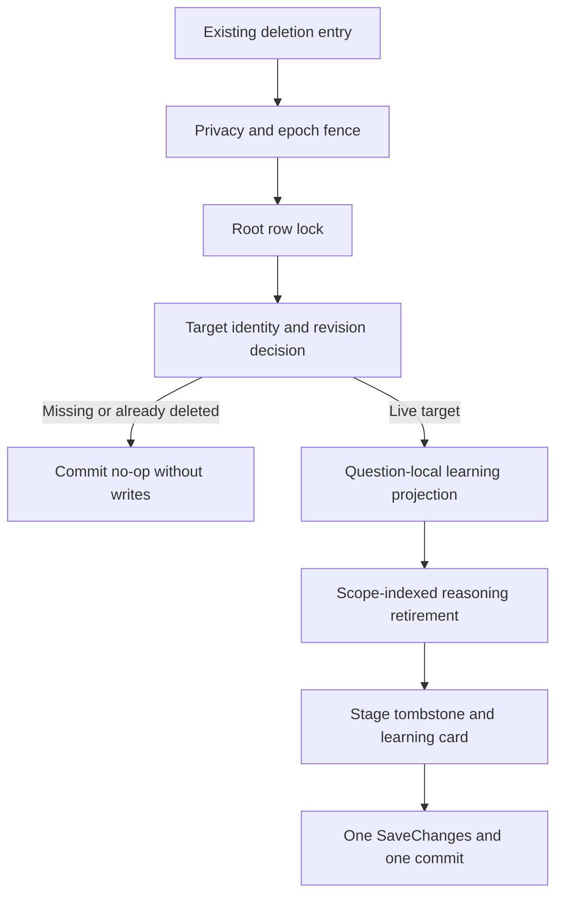

# Reasoning retirement: proposed canonical storage boundary

27 November 2026. **PROPOSED — independent design review required; not implemented.**

This document extends JARVIS's existing runtime architecture. It proposes a physical storage change for three existing collections, followed by a scoped implementation of the existing source-retirement operation. It introduces no business entity, provider ledger, history, service, agent, API, grant or scheduled purge. Forge remains a project inside JARVIS; its official programme dates remain 1 December 2026 to 18 August 2027. Interview coaching, offline behavior, privacy, protected-entry requirements and the global AI budget remain requirements.

## Source and authority

| Boundary | Exact source | Meaning |
|---|---|---|
| Approved baseline | `ca2d9dc13f94db67c3142675d358d906b05c3050` | Development through PR42; 25 migrations. This documentation branch starts here. |
| Training prerequisite | [PR45](https://github.com/lordhynet/JARVIS/pull/45), `6ddc5892da60c3f2449dcbaf99760c3cfc4733a3`, tree `6392150805809922970313b90c54e679c13ea662` | Combined canonical training extraction, scoped correction and deletion; 26 migrations in that draft. Entire source still independently unreviewed and unmerged. |
| Separate Forge work | [PR47](https://github.com/lordhynet/JARVIS/pull/47), `932386c41dd5129e4ac3f45d19719926e24b4af9`, tree `77ac717122066951dea35ddfdec80486bcfef789` | Green source gates; independent review pending. No source from it is imported here. |

The canonical training extraction design and `CLAUDE_REVIEW_TRAINING_EXTRACTION_DESIGN_2026-11-21.md` approved moving **TrainingAttempts and TrainingOperations only**, with X1–X4 additions. They did not approve extracting reasoning state. This proposal requires a new decision. Resolve any newer PR45 review findings and integrate its independently approved source before implementing this dependency; rebase and re-review this design if that changes its assumptions.

Repository constraints remain [schema compatibility](SCHEMA_COMPATIBILITY.md), [protected recovery](PROTECTED_RECOVERY.md), [training preservation](TRAINING_STORAGE_PRESERVATION.md) and [the training projection input boundary](adr/0039-training-projection-input-boundary.md). These documents and the exact PR45 source outrank an illustrative implementation name here. No migration number is allocated by this proposal.

## Problem and reuse

[PR45 deletion](https://github.com/lordhynet/JARVIS/blob/6ddc5892da60c3f2449dcbaf99760c3cfc4733a3/JARVIS.CORE/src/Jarvis.Persistence/PostgresTrainingDeletion.cs) already uses indexed training and question-local learning inputs. After projecting a live deletion, it still deserializes the complete cold runtime document, calls the existing `ReasoningLifecycle.Retire`, serializes and fingerprints the whole cold state, and commits that with the tombstone and learning card. Its no-op path already avoids this work. Removing the reasoning purge to improve a timing would break privacy.

Reuse the existing retirement algorithm, privacy/epoch gate, root-row lock, question-local projection reader, card writer, codecs, lazy-unit pattern, immutable before-images, schema guard and physical restore fixtures. Keep one canonical authority for each collection and one transaction for coupled changes. Do not extend the closed learning/training kind vocabularies or create another training service.

The historical pre-extraction profile at `3e229e33863c78fc0fa4566b30f4847214ce13f8` used actual 1k/2k/10k fixtures, five warmups and 50 samples. At 10k, correction end-to-end p95 was 5,948.7719 ms; deletion was 5,222.4712 ms. Correction cold hydration was 1,277.1823 ms, learning hydration 1,295.3078 ms and combined save 3,638.2268 ms. Deletion cold hydration was 1,056.9210 ms, learning hydration 1,416.7846 ms and combined save 3,436.5676 ms. These are **historical values, not measurements of PR45 or this proposal**. Phase p95s are not additive; combined save does not identify a table's isolated cost. The 50 ms target remains unmet and unproven. No new large benchmark is justified by a prose change.

## Proposed decision and alternatives

Move the existing `ProviderAttempts`, `ProviderResults` and `RetiredReasoningScopes` collections together into one distinct canonical physical unit. `RuntimeReasoningRows` is a proposed table/CLR name, subject to design review. Its rows represent existing records and marker membership; there is no new logical domain object. Retain the public `RuntimeState` collection contracts.

| Option | Consequence | Recommendation |
|---|---|---|
| Keep PR45's whole cold document | Established behavior; unrelated cold data still participates in a live training deletion. | Retain until an approved replacement is complete. |
| Patch root JSONB in place | Still rewrites a large root value; needs a new patch/fingerprint/serializer protocol and precise unknown-field handling. Other cold consumers remain large. | Do not introduce this additional protocol for this slice. |
| Move the three existing collections into a distinct unit | Reuses the approved extraction pattern and enables scope-indexed retirement. Requires lossless migration, lazy-consumer coverage and explicit erase/restore handling. | Proposed, pending independent approval. |
| Add relational mirrors, a separate ledger, asynchronous purge or TTL-only cleanup | Adds authority/reconciliation or leaves a privacy window. | Reject for this operation. |

Proposed row key: `(Kind, Id)`, with a closed vocabulary for these three collections and JSONB preserving each original record. A retired-scope membership uses its existing scope UUID as identity, with a minimal validated representation. There is no new request ID, sequence, timestamp policy or counter. Use a distinct CLR row type to avoid cross-table tracked-identity collisions.

For attempts/results, add partial expression indexes on the existing opaque `ScopeId`, in addition to the primary key. The concrete expression, JSON property casing and parameterized query must be chosen together and demonstrated by real PostgreSQL query evidence. Do not index fingerprints, prompt/result text, scores, titles, route pricing or protected values. A new index is not permission to expose the indexed identifiers externally.

Keep the complete `ProviderAttempt` contract: identity, scope, fingerprint, route, reservation, outcome, start/completion times, source-deleted flag, voice mode, served route and per-model usage including token/cache/cost details. The separate usage reservations, commitments, receipts, approvals and reconciliations remain the financial authority. Preserve existing unknown legacy contract values rather than normalizing them as part of this move.

## Lossless transition and lazy ownership

Implement an atomic, raw-JSON migration only after approval and prerequisite integration. Do not edit shipped migrations.

1. **Up:** validate source shapes, UUID/key identity and all three collection forms before removing anything. Transfer original record JSON and marker membership without passing records through a lossy DTO serializer. Remove only those three cold properties and reset the cold fingerprint. Reject null/malformed/ambiguous/conflicting representations; preserve unrelated cold properties and raw nested values. Transaction rollback leaves the original authoritative state intact on failure.
2. **Down:** rebuild the three collections from **current** canonical rows, including records created, changed, retired or erased after Up. Refuse unknown kinds, invalid identities, conflicting cold copies and missing root rather than silently overwrite. Do not resurrect pre-Up records or reuse an initial snapshot. Drop the physical unit only after reconstruction succeeds. Up/Down/re-Up must preserve explicit offsets, route/model usage details, markers and unrelated sentinels.
3. **Loader:** add one lazy reasoning adapter alongside the existing cold/learning/training adapters. Exclude only the moved properties from cold serialization and reflection copying. Loading publishes a complete, validated unit with immutable JSON before-images; only a loaded complete unit may enter its complete diff. Unchanged rows keep their original JSON rather than being rewritten incidentally.
4. **Detach:** an identity snapshot/export must materialize all relevant units before closing deferred loaders. Close unused loaders on nonidentity return paths. Never let a detached object query a disposed context.
5. **Scoped port:** selected scope rows are partial inputs and must never be passed to the complete-unit diff. Erasure must not load pre-erasure rows into its empty after-image. Reuse the existing context/transaction instead of calling nested `IRuntimeStore.Update`.

Ordinary cohesive callbacks can still hydrate the complete reasoning unit and other large units. Extraction alone is neither a global runtime optimization nor a constant-time guarantee.

## One source-retirement transaction

Keep the current D2 privacy/epoch fence, then the shared root `FOR UPDATE` lock, then the target decision. Root locking remains the concurrency authority for normal runtime mutations, scoped training ports and whole-Core erasure. Do not add an independent lock/transaction ordering or another store service.

Extract one shared pure retirement decision if needed so the default `ReasoningLifecycle.Retire` and PostgreSQL port apply the same rules. The persistence helper is internal and receives the already-owned context and scope. It does not start a second runtime update, invent a lifecycle service or issue provider calls.

For a live training deletion, select the marker by primary key and attempts/results by scope predicate. Validate selected row kind, row/embedded identity and scope before publishing changes. Do not hydrate unrelated cold JSON, unrelated scopes, complete training history, complete learning history or private review replay results. Preserve the existing projection-before-mutation discipline.

| Existing retirement effect | Required scoped behavior |
|---|---|
| Add scope to `RetiredReasoningScopes` | Idempotently add the existing UUID marker; no expiry/pruning policy. |
| Remove matching `ProviderResults` | Delete all matching canonical cache rows, retaining no result-body copy or replacement cache. |
| Clear matching attempt fingerprints | Set `Fingerprint = ""` and `SourceDeleted = true`; preserve every other attempt field. |
| Preserve financial records | Do not delete or rewrite reservations/commitments/receipts/reconciliations to accelerate retirement. |

Prefer structural/identity metadata selection and set-based result deletion without transferring `ProviderResult.Json` response bodies. The implementation must explicitly validate selected records sufficiently to preserve fail-closed identity/shape guarantees before deletion. If that requires decoding matched cache records, document and measure the bounded-by-scope cost; do not weaken validation silently to avoid reading a body. Malformed selected rows must roll back the entire operation. The final query/codec choice is an implementation-review item.

Missing/already-deleted targets return false before reading history, cold JSON or reasoning rows, without SaveChanges, receipt allocation, sequence changes or row-version changes. Existing live-target revision rules, missing privacy baseline non-resurrection and ordinary removed-card rebuild semantics stay intact. Cancellation/failure, including after SQL SaveChanges but before commit, rolls back tombstone, card, attempt changes, cached-result deletions and marker together.

This deliberately changes a corruption boundary: PR45's live deletion refuses poisoned unrelated cold JSON because it must deserialize it. A reviewed cold-free port should ignore unrelated cold/other-scope corruption while still refusing malformed **selected** reasoning inputs. Replace that specific expectation explicitly; do not claim identical global corruption handling or remove selected-row guards.

## Privacy, provider races and consumers

**Source retirement and whole-Core erasure have different retention rules.** Keep that distinction explicit in code and acceptance tests.

| Path | Required behavior after the move |
|---|---|
| Training/coaching/session/import/agent source retirement | Shared retirement semantics; marker/cache removal/fingerprint clearing atomic with source changes. Preserve provider-attempt accounting metadata. |
| Whole-Core erasure | `PrivacyData.EmptyAfterErase` leaves all three reasoning collections empty. Delete all their canonical rows atomically with erasure/epoch changes; do not copy attempt records back merely because source retirement retains them. Retain the separate financial records exactly as today. |
| Late usage settlement | Settle the existing financial reservation as today. Update an existing voice attempt only if present; never recreate an attempt cleared by whole-Core erasure. |
| Prepare/dispatch/result publication | Preserve source-current checks before preparation, immediately before dispatch and before publishing completion/cache results. A late result for a retired source must not restore source content or a reusable fingerprint. |
| Public privacy export | Read canonical attempts/results within the existing repeatable-read snapshot. `CoreDataExport` currently does not expose `RetiredReasoningScopes`; do not silently extend its public DTO. |
| Physical backup/restore | Preserve all three collections, including markers not present in the public export. Restore is not equivalent to importing the public export. |
| Retention/cache expiry | Keep current selection and behavior, including expiry's fingerprint invalidation without inventing a source-deleted flag or provider-attempt/marker pruning policy. |

Audit and test these existing consumers rather than introducing alternatives:

- `ReasoningLifecycle`, training and coaching purge, recorded-practice privacy, import/workflow deletion, AgentRuntime task/run retirement and planning cache invalidation.
- `ManagedAi.RequireSourceCurrent`, `TextReasoningService` and reasoning adapters, including idempotency/refusal/uncertain outcomes and delayed provider completion.
- `UsageBudget`/voice transitions, `UsageAccounting.Settle`, budget approval joins and route/model-usage attribution.
- `PrivacyData` and `PostgresPrivacyStore` export/count/retention/erase, `RuntimeMaintenance`, both store implementations, composite callbacks and detached identity snapshots.

Provider network work remains outside database locks. Use deterministic fake adapters for race tests; no paid-provider smoke. Test both lock orderings of delete versus dispatch/publication/settlement, and erase versus late completion. Preserve the financial outcome when privacy prevents publishing content. A schema move must not change global budget caps, consent, duplicate-charge guards, retry/refusal behavior or permit automatic replay.

For PostgreSQL erasure, extend the existing explicit table-delete/adapter-suppression approach used by PR45 training erasure: suppress repopulation of the reasoning unit and delete its rows inside the same transaction. Snapshot/count/retention reads must address the new authority. Do not rely on an unloaded lazy dictionary appearing empty.

## Compatibility and recovery remain gates

The existing unknown/pending-migration startup guard and designated migrator are prerequisites, not a retrofit of already-shipped writers. Stop writers, verify a fresh backup, establish a supported guard-bearing rollback baseline and mechanically prevent unguarded reconnecting writers before any deployment. A one-time session check does not close G1. This document authorizes no live migration, rollback, deployment, trust change or app installation.

Extend the existing physical training footprint and migration fixture with all three reasoning collections, real source retirement, voice/model usage metadata, a late-settlement case and post-Up erase. Prove Up/Down/re-Up and restore equality from current rows, no-write replay, fail-closed purged/deleted requests and no content resurrection. Use synthetic disposable databases only.

D1 additionally requires verified database plus active/retained keys, a decrypt marker, recordings where applicable and reconciliation of deletions occurring after backup. Synthetic restore/migration tests do not satisfy that operational gate. Do not add a deletion journal or choose a post-backup reconciliation policy implicitly. Current unbounded retirement markers and training operation receipts remain unbounded pending a separate reviewed retention policy.

## Dependency-ordered implementation backlog

| Priority / slice | Dependencies | Acceptance criteria |
|---|---|---|
| P0 — independent decision | This proposal and exact PR45 source review | Record approval of the three-collection boundary, scope query/validation approach and corruption boundary. Resolve PR45 findings, merge only independently approved prerequisites, update exact refs and plan before runtime changes. |
| P1 — shared semantic boundary | P0 | Default retirement and prospective port share one decision/contract. Tests preserve every attempt field except fingerprint/source-deleted, cache removal, idempotent marker and no financial mutation. No schema change in this slice. |
| P2 — canonical migration and adapter | P1 | Lossless raw Up/Down/re-Up; selected unknown/null/identity/conflict refusal; no dual copies; distinct CLR/table; opaque indexes; complete lazy diff/detach/closure; default-store parity; explicit export/count/retention/erase and late settlement tests. Extend the existing physical fixture instead of duplicating it. |
| P3 — scoped deletion integration | P2 | Existing deletion entry, D2/root ordering, one context/Save/commit; no-op performs no Save/history/cold/reasoning read and no row-version change. SQL capture proves parameterized scope predicates, async I/O, no cold-document hydration and no unrelated scope/large review payload read. Real PostgreSQL identity, projection, both race orderings, two-host duplicate deletion, stale/erased epoch, cancellation and post-Save fault cases preserve atomicity. Document selected cache validation and query plans. |
| P4 — exact-source integration review | P3 | Focused meaningful local tests plus all affected full CI suites green on the exact review tree, with raw artifacts and named outcomes. Explicitly account for skipped benchmarks and path-skipped clients. Independent review of the entire combined source; no self-approval. G1/D1 stay separately open. |
| P5 — matched-volume acceptance | P4 and justified ready implementation | Repeat actual 1k/2k/10k fixtures, five warmups and 50 samples per operation. Capture end-to-end and separate cold/learning/reasoning/query/save/lock phases, no-op/MVCC evidence, reasoning fanout and intact route/model-usage accounting. Report the 50 ms target honestly, including remaining cohesive callbacks, lock wait and dominant costs. Never sum phase p95s or attribute combined save to one table without evidence. |

P2 acceptance must include changed/unchanged JSON preservation, current-row Down after post-Up insert/update/retire/global erase, refusal rollback, marker identity, empty/nonempty units and malformed selected records. P3 must retain existing question-local learning/receipt/projection coverage and prove unrelated cold/other-scope poison is untouched. Unrelated malformed canonical rows must not be silently repaired or rewritten. Complete-unit consumers continue to validate the complete unit.

The seven existing opt-in benchmark skips in ordinary CI are not P5 acceptance. Documentation-only CI validates the unchanged approved baseline; it cannot validate a proposed schema, query, transaction, latency or operational recovery.

## Launch and product constraints

This storage work is a shared Core infrastructure prerequisite, not another Forge subsystem or an excuse to replace existing coaching. Keep the December 1 essentials on the current reviewed backlog and preserve the full interview programme. The separate Forge read views remain suggestions, not protected capacity or activation authority. No launch completion follows from drafting or approving this document.

Android remains an audio-only secure companion. Windows/screensaver and Watch7 consume Core-owned capabilities through their existing boundaries; this proposal adds no native business dashboard, watch data authority, background upload queue or new action grant. Offline restrictions and encrypted legacy drafts remain intact. Do not claim hardware, owner-entry, protected-key, retention, PF08 caller, PF10 storage/activation, release or recovery acceptance from synthetic tests or green CI.

## Review decisions requested

Approve or amend the distinct three-collection canonical boundary and dependency ordering; the shared pure retirement decision with a transaction-local scoped adapter; the selected-cache structural validation/body-read tradeoff; explicit source-retirement versus global-erasure rules; the unrelated-cold corruption boundary; lossless current-row migration and physical restore requirements; and the proposed acceptance backlog. Until that decision, keep PR45's existing canonical cold retirement behavior and make no reasoning storage implementation changes.
